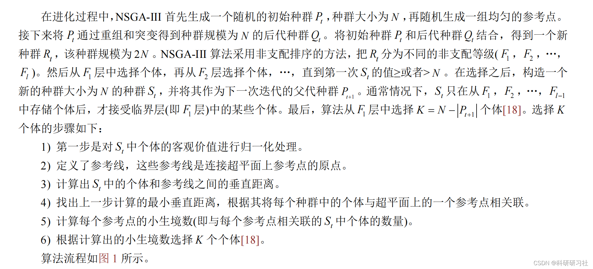
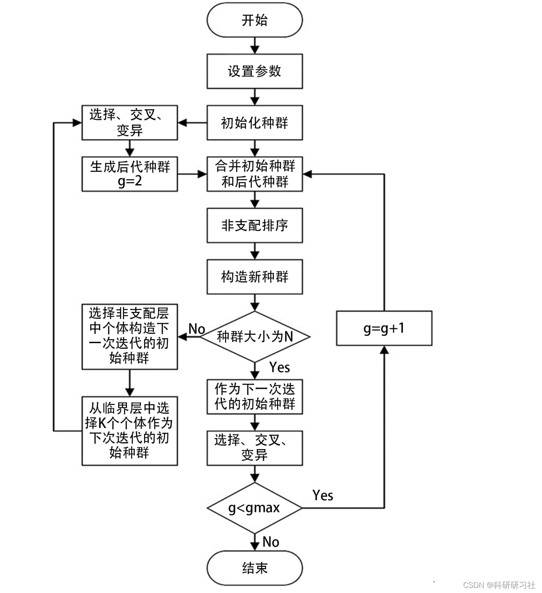
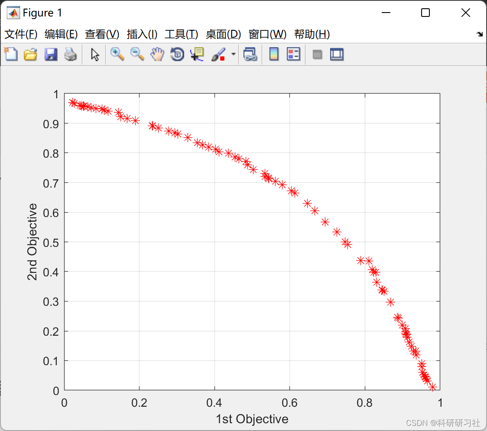
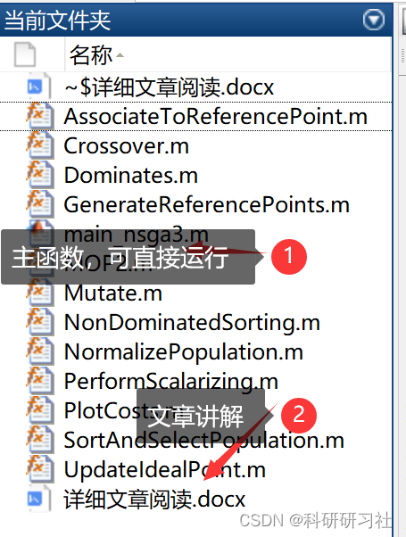
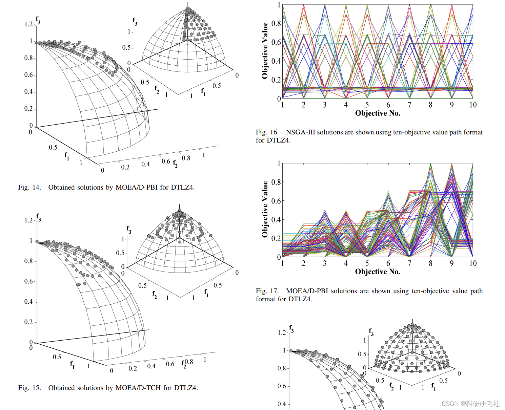

# NSGA-III optimization algorithm (Matlab code implementation)

1. Introduction to NSGA-II
The NSGA-III algorithm is a non-dominated sorting genetic algorithm based on the framework of NSGA-II, with a reference point-based selection mechanism. Although the basic frameworks are similar, there are significant changes in the selection system. Unlike NSGA-I, NSGA-II maintains the diversity among population individuals by relying on small niche numbers to provide and update reference points [16]. The NSGA-II has good adaptability and higher convergence rate. This algorithm generates offspring populations based on genetic operators, employs an elite preservation strategy using reference point selection, significantly enhancing the computational efficiency of diverse elite solutions in the non-dominated layer [17].
2. Basic Process
3. Running Results
4. Matlab Code Implementation
This article only showcases part of the code, all codes and detailed articles can be accessed by clicking the link:
NSGA-III Optimization Algorithm (Matlab Code Implementation)
\n \n\nfunction [pop, d, rho] = AssociateToReferencePoint(pop, params)\n\n    Zr = params.Zr;\n    nZr = params.nZr;\n    \n    rho = zeros(1, nZr);\n    \n    d = zeros(numel(pop), nZr);\n    \n    for i = 1:numel(pop)\n        for j = 1:nZr\n            w = Zr(:, j)/norm(Zr(:, j));\n            z = pop(i).NormalizedCost;\n            d(i, j) = norm(z - w'*z*w);\n        end\n        \n        [dmin, jmin] = min(d(i, :));\n        \n        pop(i).AssociatedRef = jmin;\n        pop(i).DistanceToAssociatedRef = dmin;\n        rho(jmin) = rho(jmin) + 1;\n        \n    end\n\nend\n  
Editor
Editor
​  

## Images

<!-- PAYMENT_BLOCK -->

## Get this dataset

- Payment link (Stripe): [Buy now](https://buy.stripe.com/3cs8yP7sY87d0vu9AB)
- Payment QR code: 

<!-- /PAYMENT_BLOCK -->
